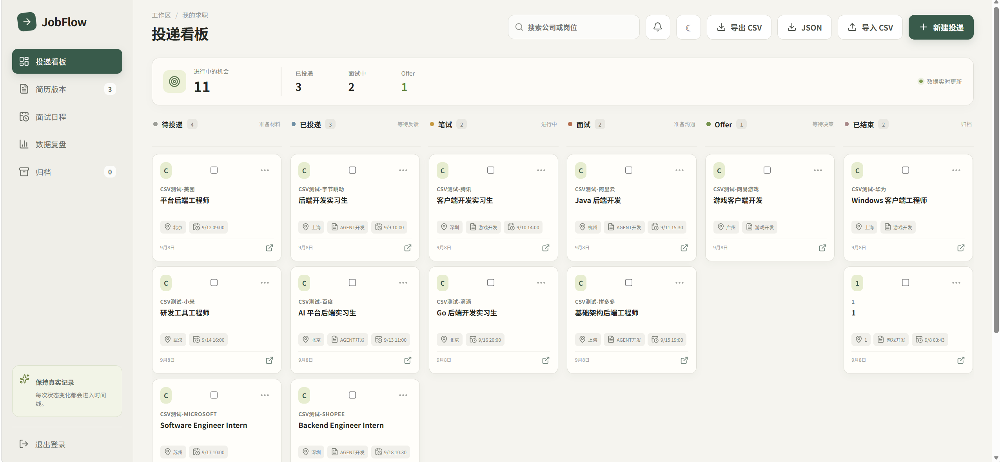
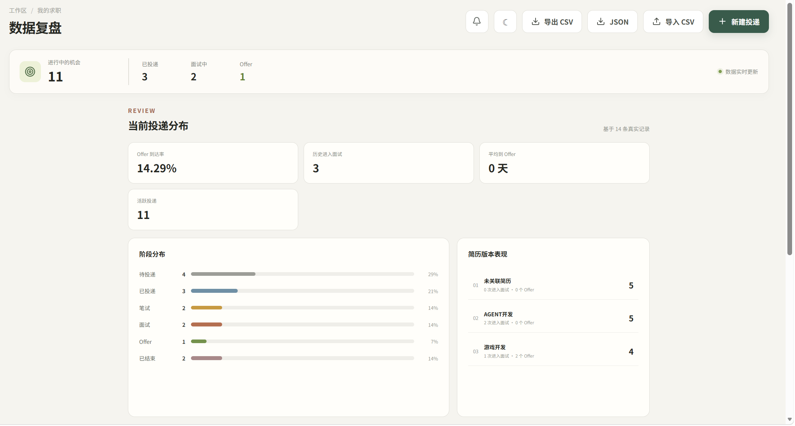
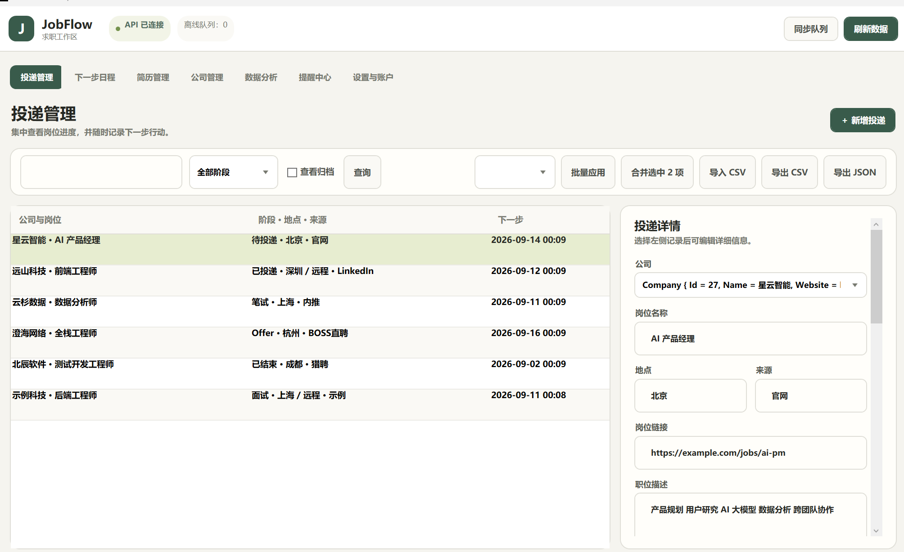
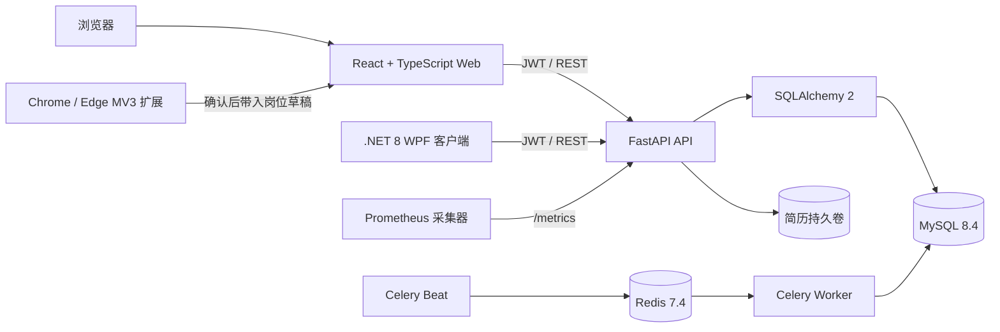
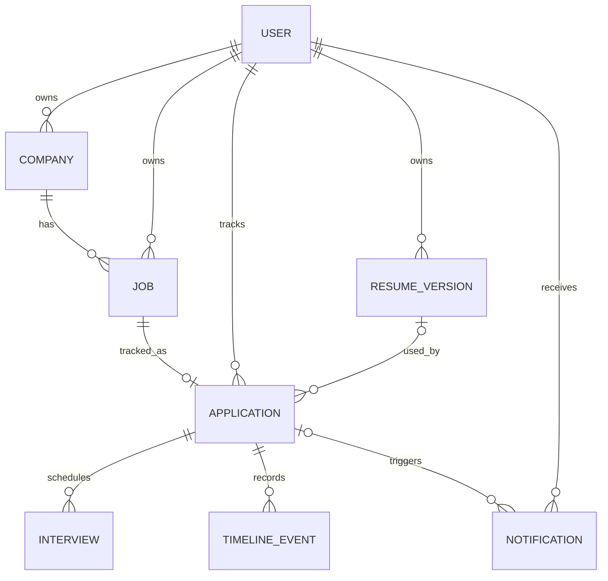

# JobFlow

> 本地优先的求职流程管理工具：用一套数据同时驱动 Web 看板、Windows 桌面客户端和浏览器岗位采集扩展。

**当前版本：** `0.3.0` · **许可证：** MIT · **默认部署边界：** 单台电脑、本机回环地址

JobFlow 用于集中管理公司、岗位、简历版本、投递阶段、面试安排和后续行动。它既可以通过 Docker Compose 运行完整 Web 服务，也可以作为内置 API 与 SQLite 的 Windows 桌面应用独立运行。JD/简历匹配完全使用本地、可解释的关键词规则，不会把简历发送给第三方 AI。

- [功能概览](#功能概览)
- [界面预览](#界面预览)
- [系统架构](#系统架构)
- [技术栈](#技术栈)
- [快速开始](#快速开始)
- [开发与测试](#开发与测试)
- [安全与数据](#安全与数据)

## 界面预览

### Web 投递看板

六阶段看板集中呈现全部机会，支持拖拽流转、批量操作、搜索、简历关联和下一步时间提醒。



### Web 数据复盘

通过阶段分布、Offer 到达率、来源表现、简历版本表现和周趋势复盘真实投递效果。



### Windows 桌面客户端

原生 WPF 客户端提供投递、日程、简历、公司、分析、提醒和账户管理，并支持离线队列及内嵌本地服务。



## 功能概览

### 投递工作流

- `待投递 → 已投递 → 笔试 → 面试 → Offer → 已结束` 六阶段流程。
- Web 看板拖拽状态，桌面端列表筛选与批量状态更新。
- 每次状态变化进入时间线；保存失败时客户端回滚界面状态。
- 投递归档与恢复、最近一次状态撤销、重复投递合并。
- 公司、岗位、地点、来源、岗位链接、JD、标签、自定义字段和备注管理。
- 下一步行动时间、周/月日程以及 ICS 日历导出。

### 简历与面试

- 管理多个简历版本，支持 PDF、DOC、DOCX 上传和鉴权下载。
- 文件扩展名、5 MB 大小限制、内容签名和安全文件名校验。
- 为投递关联简历，并统计不同简历版本进入面试和获得 Offer 的表现。
- 创建多轮面试、检测时间冲突、记录轮次结果并生成提醒。
- 在本地比较 JD 与简历文本，输出分数、匹配关键词、缺失关键词、准备问题和建议。

### 数据与效率

- 当前阶段分布、历史阶段到达、阶段耗时、Offer 到达率及平均 Offer 周期。
- 岗位来源表现、简历版本表现和近 12 周投递趋势。
- UTF-8 CSV 批量导入、CSV/JSON 数据导出。
- 常用备注模板、剪贴板岗位链接读取、空工作区示例数据和深色模式。
- 长期无反馈提醒、下一步行动提醒、每周报告、失败重试与持久化失败记录。

### 多端使用

- **React Web：** 看板、日程、分析、提醒、导入导出和完整投递详情。
- **Windows 桌面端：** 原生 WPF 工作区、系统托盘、开机启动、全局 `Ctrl+Shift+N`、备份和更新检查钩子。
- **Chrome / Edge 扩展：** LinkedIn、BOSS 直聘、猎聘及通用招聘页面采集，提交前可编辑预览；API 不可用时进入离线队列。

> 当前 Web 端提供公司/岗位搜索；状态、来源筛选和分页能力已由 API 提供，桌面端已经暴露相应控件。Web 的账户设置入口仍待补齐。联系人与内推关系管理不在 `0.3.0` 范围内。

## 系统架构



### Docker Web 运行模式

1. Nginx 提供 Vite 构建后的静态 Web 页面，默认监听 `127.0.0.1:5173`。
2. Web 使用 JWT 调用 `127.0.0.1:8000/api/v1` 上的 FastAPI 服务。
3. SQLAlchemy 通过 PyMySQL 访问 MySQL；Alembic 负责数据库版本升级。
4. Celery Beat 发布周期任务，Redis 作为消息代理，Worker 生成幂等提醒及周报。
5. MySQL、Redis 和上传文件使用 Docker 命名卷持久化。

### Windows 独立运行模式

正式桌面包内置由 PyInstaller 打包的 FastAPI 服务、SQLite 数据库和提醒调度器。WPF 客户端自动启动本机服务并通过回环地址通信，因此普通用户无需安装 Docker、Python、MySQL、Redis 或 .NET Runtime。

桌面数据默认保存在 `%LOCALAPPDATA%\JobFlow`，包含 SQLite 数据库、上传文件、运行日志及为当前用户生成的服务密钥。升级和普通卸载不会主动删除这些数据。

### 核心数据关系



更多运行边界、ER 图与可靠性说明参见 [架构文档](docs/architecture.md)。

## 技术栈

| 层级 | 主要技术 | 用途 |
| --- | --- | --- |
| Web | React 19、TypeScript 6、Vite 8、Lucide React | 单页应用、看板与响应式交互 |
| Web 测试 | Vitest、Testing Library、Playwright | API/组件测试和真实浏览器 E2E |
| API | Python 3.11+、FastAPI、Pydantic Settings、Uvicorn | REST API、配置、校验与服务运行 |
| 数据访问 | SQLAlchemy 2、Alembic、PyMySQL | ORM、迁移和 MySQL 驱动 |
| 鉴权 | JWT、PBKDF2-HMAC-SHA256 | 会话令牌和加盐密码哈希 |
| 异步任务 | Celery 5、Redis 7.4、Celery Beat | 提醒、周报、重试和任务调度 |
| 数据库 | MySQL 8.4 / SQLite | Docker Web 持久化 / 桌面内嵌存储 |
| 桌面端 | .NET 8、WPF、Windows Forms Tray | Windows 原生客户端与系统集成 |
| 浏览器扩展 | Manifest V3、原生 JavaScript | 岗位页面识别、预览和离线队列 |
| 可观测性 | Prometheus Python Client、结构化请求日志 | 健康检查、请求计数和延迟指标 |
| 交付 | Docker Compose、Nginx、PyInstaller、Inno Setup | Web 编排和 Windows 自包含发布 |
| CI/CD | GitHub Actions、Dependabot | 多端测试、镜像和 Release 构建 |

## 快速开始

### 方式一：Docker Compose 运行 Web

要求：Windows PowerShell、Docker Desktop。

```powershell
# 克隆仓库后进入项目根目录
cd jobflow

# 首次运行：从 .env.example 创建 .env，并生成随机 JWT 密钥
.\tools\init-local.ps1

docker compose up -d --build
docker compose ps
```

启动后访问：

- Web：<http://localhost:5173>
- OpenAPI 文档：<http://localhost:8000/docs>
- 健康检查：<http://localhost:8000/health>
- Prometheus 指标：<http://localhost:8000/metrics>

首次进入 Web 后注册本地账户。空工作区可点击“创建示例数据”快速体验全部页面。

停止服务但保留数据：

```powershell
docker compose down
```

> 不要对包含真实数据的环境执行 `docker compose down -v`，该命令会删除数据库、Redis 和上传文件卷。

### 方式二：Windows 桌面客户端

从 GitHub Releases 下载 Windows x64 ZIP 或安装包。ZIP 解压后运行 `JobFlow.Desktop.exe`；安装版按向导操作即可。桌面正式包为自包含构建，无需另装运行时。

也可以从源码启动：

```powershell
cd desktop\JobFlow.Desktop
dotnet restore --configfile ..\NuGet.Config
dotnet run
```

构建 Windows x64 发布包：

```powershell
.\tools\package-release.ps1
```

输出位于 `artifacts/jobflow-desktop-win-x64.zip`；检测到 Inno Setup 时还会生成 `jobflow-desktop-setup-win-x64.exe`。

### 浏览器扩展

1. 启动 JobFlow Web 与 API。
2. 打开 `chrome://extensions` 或 `edge://extensions`，启用开发者模式。
3. 选择“加载已解压的扩展程序”，指向仓库中的 `extension` 目录。
4. 在招聘页面点击扩展图标，检查并编辑识别结果后导入 JobFlow。

扩展只在用户主动点击后读取当前标签页，不会后台抓取，也不会代替用户投递。

## 本地开发

### 后端

```powershell
cd backend
python -m venv .venv
.venv\Scripts\Activate.ps1
pip install -c constraints.lock -e ".[dev]"
alembic upgrade head
uvicorn app.main:app --reload
```

默认开发配置可使用 SQLite；Compose 环境使用 MySQL。所有正式结构变更都必须新增 Alembic migration，应用启动不会隐式调用 `create_all()`。

### 前端

要求 Node.js `>=24 <25`：

```powershell
cd frontend
npm install --cache ..\.npm-cache
npm run dev
```

如 API 不在默认地址，可在构建或开发环境中配置 `VITE_API_URL`。

### CSV 导入格式

CSV 必须使用 UTF-8 编码并包含 `company,title`，可选字段如下：

```csv
company,title,status,location,source,source_url,resume_version,next_action_at,notes,jd_text
Example Labs,Backend Engineer,applied,Shanghai,referral,https://example.com/job,Backend v2,2026-09-10T09:00:00+08:00,Follow up,Job description
```

单次最多 500 行、1 MB。重复岗位会跳过，无效行会返回行号和原因。

## API 概览

所有业务接口位于 `/api/v1`，除注册和登录外均要求 Bearer Token。

| 资源 | 能力 |
| --- | --- |
| `/auth` | 注册、登录、修改密码、删除账户 |
| `/companies`、`/jobs` | 公司与岗位生命周期管理 |
| `/resumes` | 简历版本、上传、下载和匹配文本 |
| `/applications` | 投递、状态、归档、时间线、面试与本地匹配 |
| `/application-actions` | 批量状态变更 |
| `/dashboard` | 漏斗和复盘指标 |
| `/notifications` | 提醒查询和已读状态 |
| `/applications-import.csv` | CSV 导入 |
| `/applications-export.csv`、`/applications-export.json` | 数据导出 |
| `/calendar.ics` | 日历导出 |

完整请求/响应模型可在运行后查看 `/docs`。

## 开发与测试

提交前建议执行完整验证：

```powershell
# Backend: lint + 23 tests + 100% line coverage
cd backend
.venv\Scripts\python.exe -m ruff check app tests migrations ..\tools\check-version.py
.venv\Scripts\python.exe -m pytest -q --cov=app --cov-fail-under=100

# Frontend: lint + component/API tests + production build
cd ..\frontend
npm run lint
npm test
npm run build

# Live browser E2E，需要先启动完整 Compose 栈
npm run test:e2e

# Browser extension
cd ..\extension
npm run check
npm test

# Windows desktop
cd ..\desktop\JobFlow.Desktop
dotnet build --configuration Release
```

项目 CI 分别验证后端、前端、浏览器扩展、Windows 桌面包和 Docker 端到端流程。版本一致性可单独检查：

```powershell
backend\.venv\Scripts\python.exe tools\check-version.py
```

## 备份、恢复与冒烟测试

```powershell
# 创建 MySQL 与上传文件备份
.\tools\backup.ps1

# 恢复会替换当前数据库和上传目录，请只传入已确认的备份
.\tools\restore.ps1 -BackupDirectory .\backups\YYYYMMDD-HHMMSS

# 对已运行环境做登录和核心查询冒烟测试
$env:JOBFLOW_SMOKE_EMAIL = "your-account@example.com"
$env:JOBFLOW_SMOKE_PASSWORD = "your-password"
.\tools\smoke-test.ps1
```

## 安全与数据

- 官方支持边界是**单台电脑、本机自托管**；Compose 的 Web 与 API 端口默认只绑定 `127.0.0.1`。
- 不要未经额外加固就把端口改为 `0.0.0.0` 或直接暴露到公网。
- 每条业务查询都按 JWT 中的用户身份隔离。
- 密码使用带独立随机盐的 PBKDF2-HMAC-SHA256 哈希存储。
- `.env`、数据库、上传简历、备份、构建产物和测试报告均已加入 `.gitignore`。
- 仓库不应包含真实求职数据、访问令牌或个人简历。
- 正式 Windows 发布前应配置可信代码签名；未签名安装包可能触发 SmartScreen 提示。

漏洞报告和部署边界详见 [SECURITY.md](SECURITY.md)。

## 项目结构

```text
jobflow/
├─ backend/                 FastAPI、SQLAlchemy、Alembic、Celery、pytest
│  ├─ app/                  API、模型、任务、鉴权与桌面内嵌服务
│  ├─ migrations/           数据库迁移
│  └─ tests/                后端测试
├─ frontend/                React / TypeScript / Vite Web
│  ├─ src/                  页面、组件和 API 客户端
│  └─ e2e/                  Playwright 端到端测试
├─ extension/               Chrome / Edge Manifest V3 扩展
├─ desktop/                 .NET 8 WPF 客户端、运行配置和安装器
├─ docs/                    架构、发布清单与项目截图
├─ tools/                   初始化、备份、恢复、压测和发布脚本
├─ .github/                 CI、Release 与 Dependabot 配置
└─ docker-compose.yml       Web 本地自托管编排
```

## 项目状态与限制

- 当前版本面向个人、本机使用，不是经过互联网多租户加固的 SaaS。
- Windows 安装包签名和正式更新源需要由发布者配置，仓库不包含伪造证书或占位更新服务。
- 浏览器扩展负责采集和带入草稿，不会自动提交招聘网站表单。
- 本地 JD/简历匹配强调透明和隐私，不等同于语义模型或招聘决策系统。
- 联系人及内推关系管理将在明确数据模型和隐私边界后再考虑。

发布前剩余人工检查见 [发布清单](docs/release-checklist.md)，版本变化见 [CHANGELOG.md](CHANGELOG.md)，贡献规范见 [CONTRIBUTING.md](CONTRIBUTING.md)。

## License

JobFlow 使用 [MIT License](LICENSE)。
