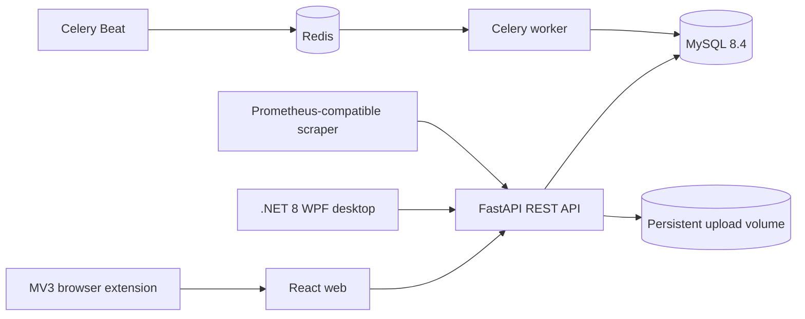
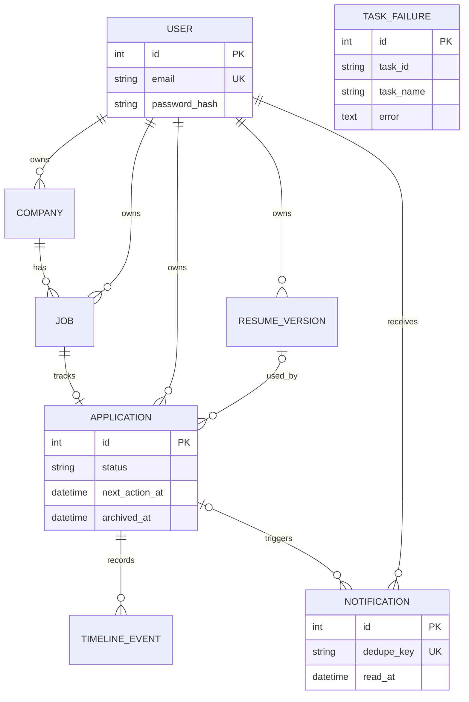

# JobFlow architecture

## Runtime view

The web app, extension, and desktop client share one authenticated API on the same computer. The supported Compose deployment binds Web and API ports to `127.0.0.1`, so another computer cannot connect without deliberately changing the unsupported network boundary. The extension only reads a page after a user click and opens a confirmation flow. Celery creates idempotent next-action, no-feedback, and weekly-report notifications; exhausted failures are recorded in `task_failures`.

## Entity relationship view

## Reliability and security boundaries

- Alembic owns schema changes; application startup never calls `create_all()`.
- Released migrations contain explicit immutable operations and are tested by upgrading a fresh database.
- The supported runtime is single-computer local self-hosting; Web and API ports are loopback-only.
- MySQL, Redis, and uploaded resumes use named volumes. Backup/restore scripts cover both database and files.
- Every business query is scoped to the authenticated user. Password hashes use PBKDF2-HMAC with a per-password salt.
- Resume uploads have a 5 MB limit, allowlisted extensions, content-signature checks, sanitized names, and authenticated downloads.
- Jobs use a per-user SHA-256 fingerprint and applications enforce one record per user/job.
- API responses include request IDs; `/metrics` exposes request count and duration histograms.
